# Plateforme bancaire - Test Adria PFE 27

Auteur : Hafssa Miftah Idrissi
Dépôt : MiftahIdrissi-Hafssa-test-adria-pfe-27

## 1. Présentation

Ce projet met en place une plateforme bancaire basée sur une architecture microservices. Elle permet de consulter des comptes bancaires, d'enregistrer des transactions et de publier des événements métier. Un assistant conversationnel (Spring AI) permettra d'interroger les données depuis un client REST ou Telegram.

Ce document décrit le travail réalisé étape par étape. Il est complété au fur et à mesure de l'avancement.

## 2. Architecture cible

| Composant | Rôle | Port prévu | 
|---|---|---|
| account-service | Gestion des comptes bancaires | 8081 | 
| transaction-service | Enregistrement et consultation des transactions, virements | 8082 | 
| discovery-service | Annuaire des services (Eureka) | 8761 | 
| config-service | Configuration centralisée (bank.transaction.max-amount=1000) | 8888 |
| gateway-service | Point d'entrée unique (Spring Cloud Gateway) | 9999 | 
| chatbot-service | Agent IA connecté aux services via MCP | 8090 | 
| transaction-consumer | Consommation des événements Kafka | à définir | 

## 3. Technologies

- Java 21
- Spring Boot 4.1.2
- Spring Cloud 2025.1.4
- Spring AI 2.0.1
- Maven (projet multi-modules)
- H2 (base de données en mémoire, pour le développement)
- Kafka, Resilience4J, OpenFeign, GraphQL, MCP (étapes suivantes)
## 4. Organisation du projet

Le projet est un projet Maven parent (`bank-platform`) qui contient un module par microservice.

```
bank-platform
  pom.xml                  (projet parent, versions communes)
  http/                    (fichiers de test HTTP)
  account-service/
    pom.xml
    src/main/java/net/hmi/bank/account
      domain/              (entités et énumérations)
      repository/          (accès aux données)
      service/             (logique métier, DTO, mapper)
      exception/           (exceptions métier)
      web/rest/            (contrôleurs REST)
      web/graphql/         (connecteur GraphQL)
      mcp/                 (outils MCP pour l'agent IA)
```

Les connecteurs REST, GraphQL et MCP appellent tous la même couche `service`. La logique métier n'est donc écrite qu'une seule fois.

## 5. Étapes réalisées

### Étape 1 - Préparation du projet (Partie A)

1. Création du dépôt GitHub privé `nom-prenom-test-adria-pfe-27`.
2. Création du projet Maven parent `bank-platform` avec IntelliJ (Java, Maven, JDK 21).
3. Configuration du `pom.xml` parent :
    - parent `spring-boot-starter-parent` 4.1.2
    - packaging `pom`
    - gestion centralisée des versions Spring Cloud et Spring AI (BOM)
    - configuration du processeur d'annotations Lombok
4. Ajout du module `account-service` dans la balise `<modules>` du parent. Chaque nouveau module sera ajouté de la même manière à sa création.

### Étape 2 - Microservice account-service (Partie C.1, REST)

#### Modèle

| Champ | Type | Remarque |
|---|---|---|
| id | UUID | généré automatiquement |
| customerReference | String | obligatoire |
| status | ACTIVE ou BLOCKED | ACTIVE à la création |
| currency | String | code de 3 lettres |
| balance | double | conforme à l'énoncé |
| version | Long | verrouillage optimiste |

#### Choix de conception

- Les mises à jour du solde passent par deux opérations explicites, `debit` et `credit`, et non par une modification directe du solde. Un virement se décompose ainsi en un débit et un crédit.
- Le service impose lui-même ses règles : le compte doit être actif et le solde ne peut pas devenir négatif.
- Le calcul du solde passe par `BigDecimal` avant d'être stocké en `double`, afin de limiter les erreurs d'arrondi.
- Le champ `version` (`@Version`) évite que deux opérations simultanées s'écrasent mutuellement.
- Les DTO d'entrée et de sortie sont séparés : le client n'envoie jamais l'identifiant, il le reçoit dans la réponse.
#### API REST

| Méthode | URL | Description | Code de succès |
|---|---|---|---|
| POST | /accounts | Créer un compte | 201 |
| GET | /accounts | Lister les comptes (filtre optionnel `customerReference`) | 200 |
| GET | /accounts/{id} | Consulter un compte | 200 |
| PATCH | /accounts/{id}/status | Bloquer ou activer un compte | 200 |
| POST | /accounts/{id}/debit | Débiter un compte | 200 |
| POST | /accounts/{id}/credit | Créditer un compte | 200 |

#### Gestion des erreurs

| Situation | Code HTTP |
|---|---|
| Données invalides (montant négatif, devise incorrecte) | 400 |
| Compte introuvable | 404 |
| Règle métier non respectée (solde insuffisant, compte bloqué) | 422 |
| Modification concurrente du même compte | 409 |

#### Lancement

```
mvn clean install
```

Puis lancer la classe `AccountServiceApplication` depuis IntelliJ. Le service écoute sur le port 8081.

#### Tests

Les tests manuels sont décrits dans le fichier `http/account.http` (client HTTP d'IntelliJ). Les requêtes sont exécutées dans l'ordre.

| N° | Scénario | Résultat attendu | Capture                 |
|---|---|---|-------------------------|
| 1 | Créer le compte A (500 EUR) | 201, compte ACTIVE | 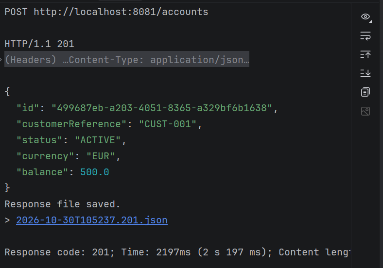     |
| 2 | Créer le compte B (100 EUR) | 201 | 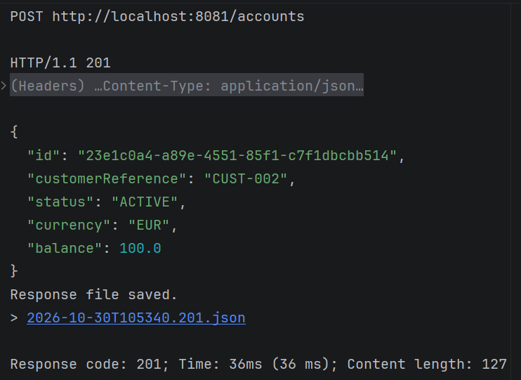 |
| 3 | Lister les comptes | 200, deux comptes | 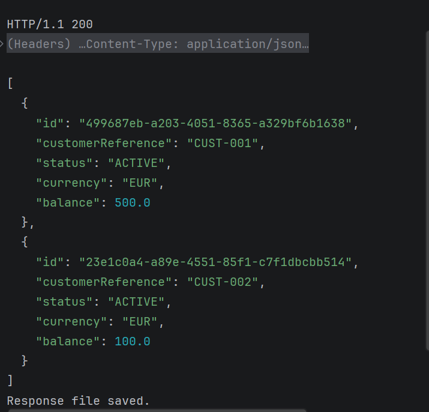 |
| 4 | Consulter le compte A | 200 | 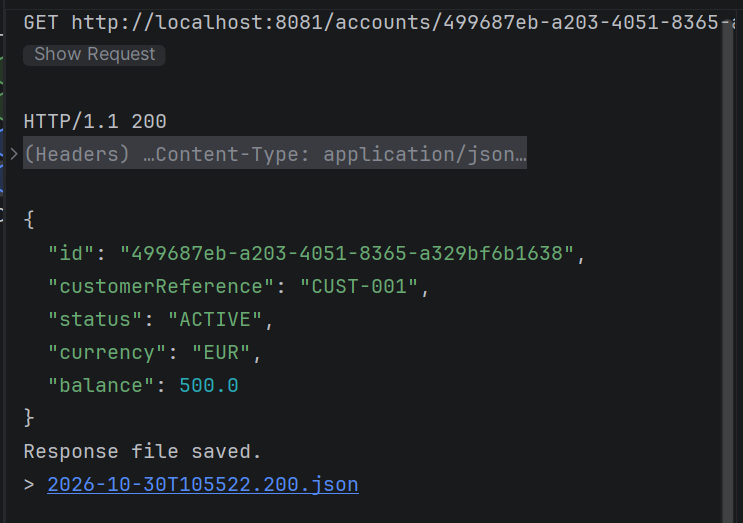 |
| 5 | Débiter A de 100 | 200, solde 400 | 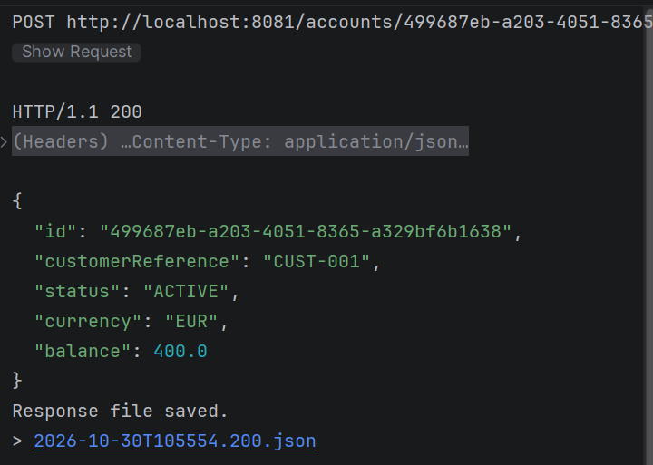 |
| 6 | Créditer B de 50 | 200, solde 150 | 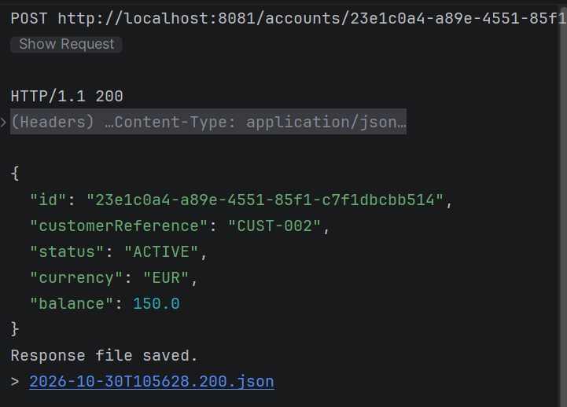 |
| 7 | Débiter A d'un montant supérieur au solde | 422 | 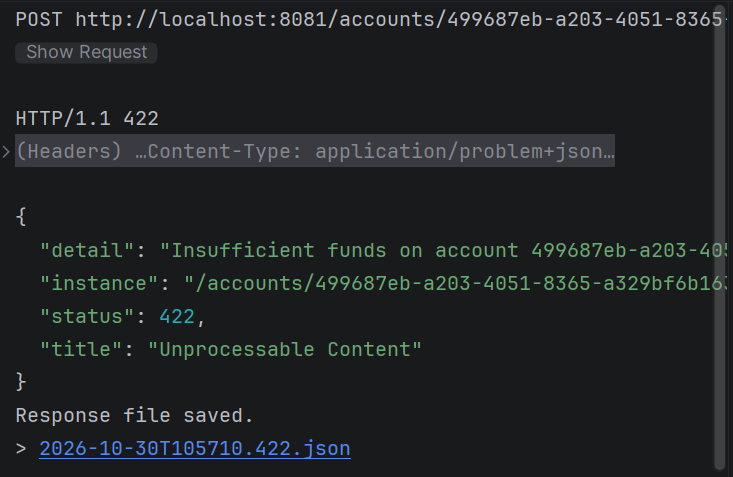 |
| 8 | Débiter A d'un montant négatif | 400 | 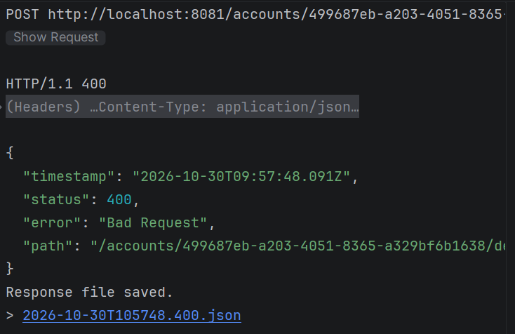 |
| 9 | Bloquer A | 200, statut BLOCKED | 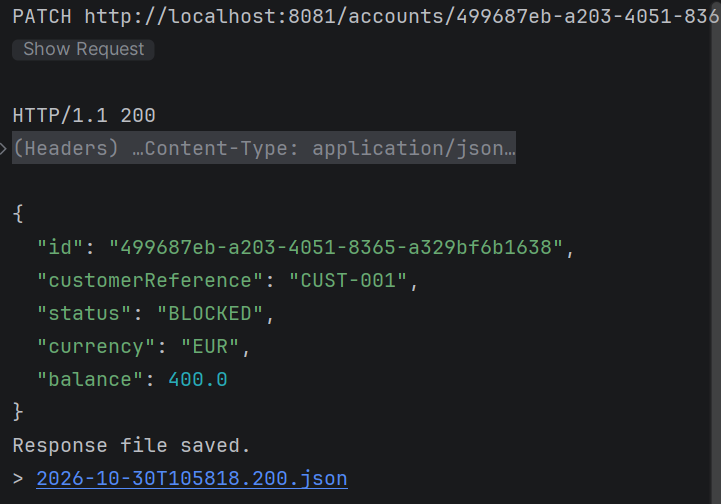 |
| 10 | Débiter A (compte bloqué) | 422 |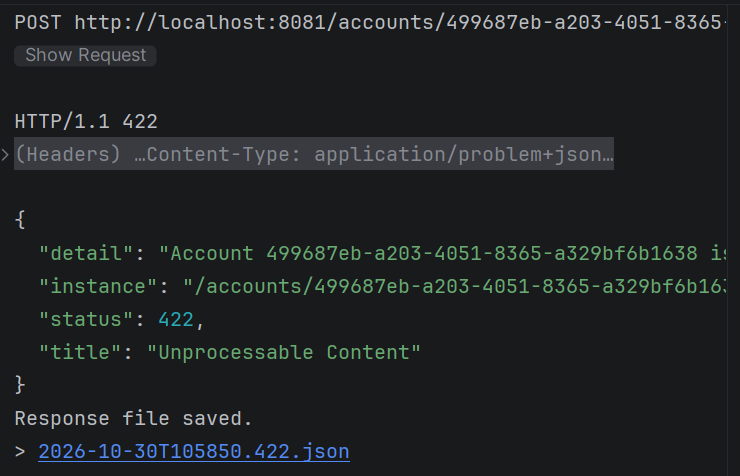                         |
| 11 | Consulter un compte inexistant | 404 | 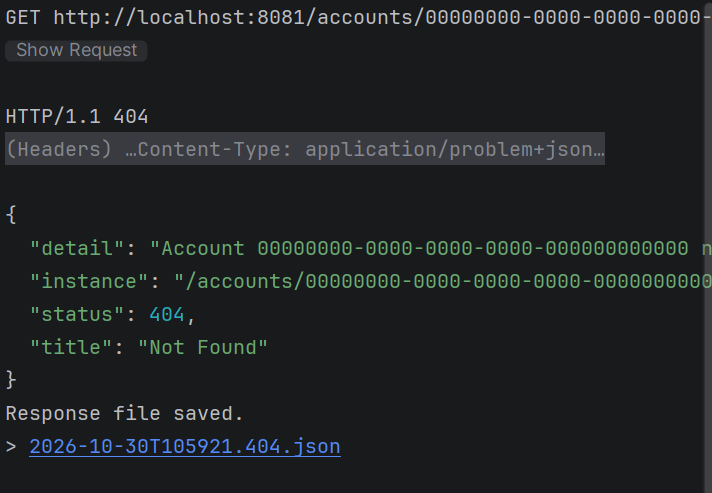|
| 12 | Créer un compte avec une devise invalide | 400 | 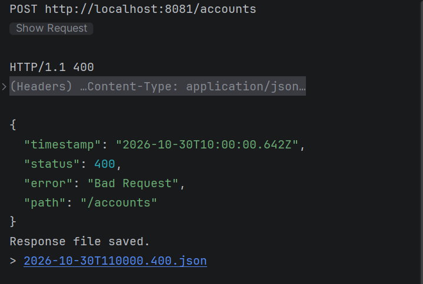|

### Étape 3 - account-service : GraphQL et MCP (Partie C.1)

Les connecteurs GraphQL et MCP appellent la même couche `AccountService` que le connecteur REST.

#### Validation dans la couche service

Les règles de validation (montant strictement positif, devise sur 3 lettres, solde initial non négatif) sont vérifiées dans la couche service. Elles s'appliquent donc quel que soit le connecteur utilisé. Le REST renvoie 400 grâce à la validation des DTO, GraphQL et MCP s'appuient sur les contrôles du service.

#### GraphQL

- Schéma : `src/main/resources/graphql/schema.graphqls`
- Point d'accès : `/graphql`, interface de test : `/graphiql`
- Requêtes : `accounts`, `account`
- Mutations : `createAccount`, `updateAccountStatus`, `debitAccount`, `creditAccount`
- Les erreurs sont converties en `NOT_FOUND` (compte inexistant) et `BAD_REQUEST` (règle métier non respectée).

#### MCP

- Point d'accès : `/mcp` (transport streamable HTTP)
- Outils exposés : `list_accounts`, `get_account`, `create_account`, `update_account_status`, `debit_account`, `credit_account`
- Les descriptions des outils guident le choix du LLM.
- Test réalisé avec MCP Inspector.

#### Tests

| N° | Scénario                     | Résultat attendu       | Capture                   |
|----|------------------------------|------------------------|---------------------------|
| 13 | GraphQL : lister les comptes | 200, liste des comptes | 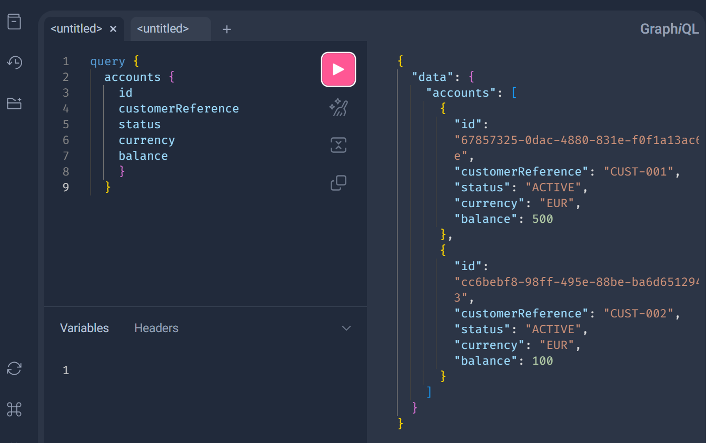 |
| 14 | GraphQL : créer un compte    | compte créé            | 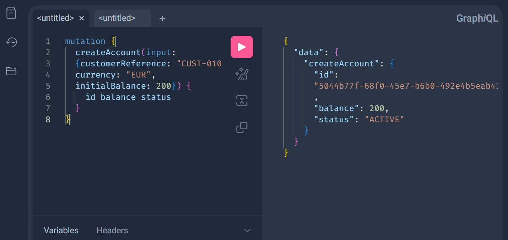 |
| 15 | GraphQL : débiter un compte  | solde mis à jour       | 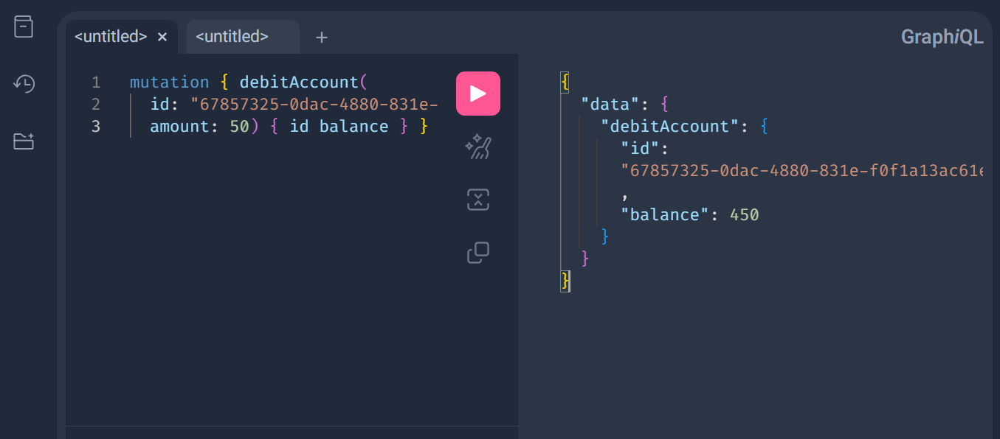                 |
| 16 | MCP : liste des outils       | 6 outils               |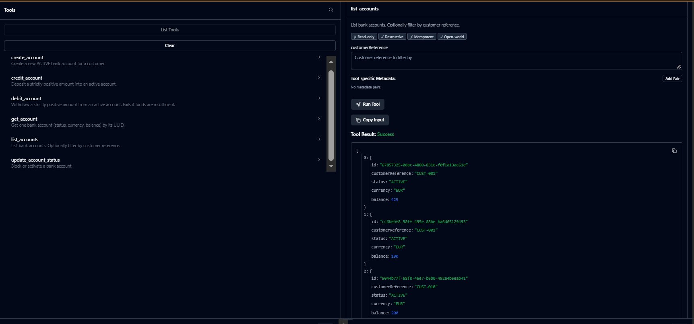|
| 17 | MCP : get account            | compte récupéré        |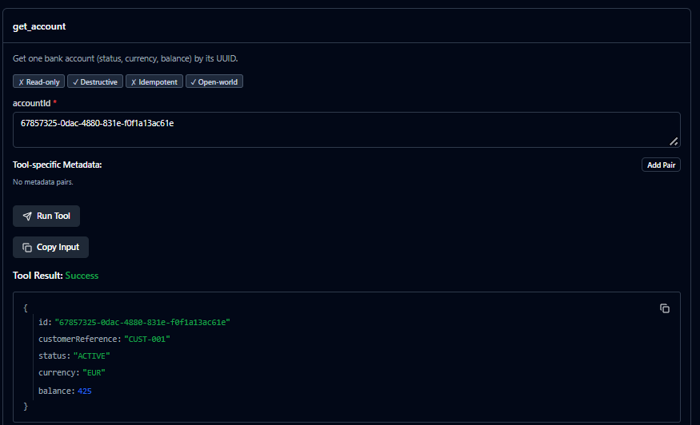|
| 18 | MCP : débiter un compte      | succes                 |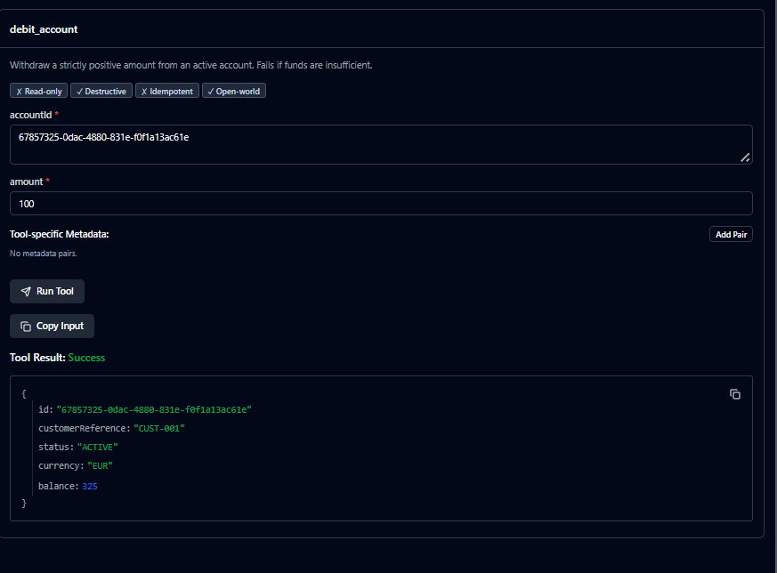|


### Étape 4 - transaction-service, OpenFeign et Resilience4J (Partie C.2 et C.3)

#### Modèle

| Champ | Type | Remarque |
|---|---|---|
| id | UUID | généré automatiquement |
| accountId | UUID | compte concerné |
| amount | BigDecimal | montant strictement positif, plafonné |
| currency | String | doit correspondre à la devise du compte |
| merchantCategory | String | "TRANSFER" pour un virement |
| country | String | vide pour un virement |
| createdAt | Instant | date de création |
| type | PAYMENT, TRANSFER_OUT, TRANSFER_IN | ajout au modèle minimal |
| transferId | UUID | lie les deux écritures d'un virement, ajout au modèle minimal |

L'entité est nommée BankTransaction pour éviter les conflits avec les types Transaction de JPA et de Spring.

#### Règles métier

1. Le montant est strictement positif et inférieur ou égal à `bank.transaction.max-amount` (1000, fourni plus tard par le config-service).
2. Le compte doit exister (sinon 404) et être actif.
3. La devise de la transaction doit correspondre à celle du compte.
4. Le solde du compte est consulté avant chaque transaction et doit couvrir le montant.
5. La transaction est enregistrée, puis le compte est débité. Si le débit échoue, l'enregistrement est annulé.

Les règles sont vérifiées dans la couche service, pour qu'elles s'appliquent à tous les connecteurs.

#### Virement

`POST /transfers` débite le compte source puis crédite le compte destination. Si le crédit échoue, le débit est annulé par une opération compensatoire. Si cette annulation échoue aussi, l'erreur est journalisée pour un rapprochement manuel. Les deux écritures partagent le même `transferId`. Le plafond s'applique aussi aux virements (hypothèse).

#### Communication avec account-service (OpenFeign)

Le client `AccountClient` appelle `GET /accounts/{id}`, `POST /accounts/{id}/debit` et `POST /accounts/{id}/credit`. Un décodeur d'erreurs transforme les réponses HTTP en exceptions métier (404 : introuvable, autres 4xx : règle métier, 5xx : indisponible).

#### Tolérance aux pannes (Resilience4J)

| Mécanisme | Paramétrage |
|---|---|
| Circuit breaker | fenêtre de 10 appels, minimum 5 appels, ouverture à 50 % d'échecs, 10 secondes en état ouvert, 2 appels en semi-ouvert |
| Time limiter | 3 secondes |
| Timeouts Feign | connexion 1 s, lecture 2 s |
| Erreurs ignorées par le circuit | 404 et 422, ce sont des erreurs fonctionnelles |
| Repli (fallback) | exception claire, réponse 503 |

Pas de nouvelle tentative automatique sur le débit et le crédit : ces opérations ne sont pas idempotentes, et une nouvelle tentative pourrait débiter deux fois le compte. Le repli ne simule jamais un succès.

#### API REST

| Méthode | URL | Description | Succès |
|---|---|---|---|
| POST | /transactions | Enregistrer une transaction | 201 |
| GET | /transactions | Lister (filtre optionnel accountId) | 200 |
| GET | /transactions/{id} | Consulter une transaction | 200 |
| POST | /transfers | Effectuer un virement | 201 |

#### Tests

| N°  | Scénario | Résultat attendu | Capture                                             |
|-----|---|---|-----------------------------------------------------|
| T1  | Paiement de 100 sur le compte A | 201, solde de A égal à 400 | 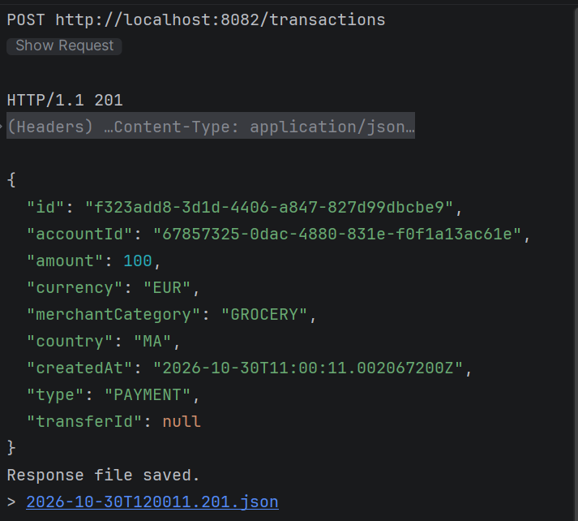 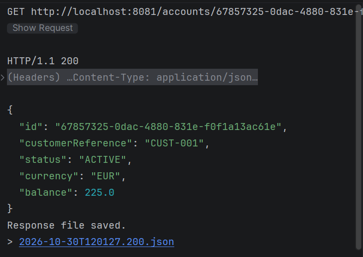 |
| T2  | Montant 1500 | 422 (plafond) | 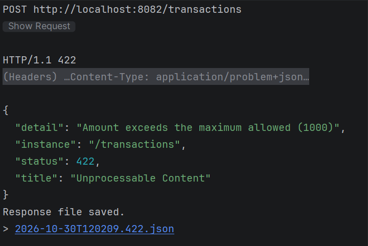                           |
| T3  | Montant négatif | 400 | 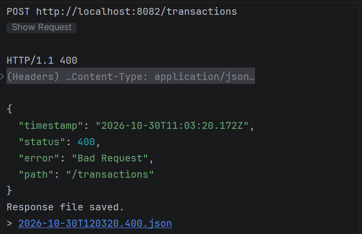                           |
| T4  | Devise différente de celle du compte | 422 | 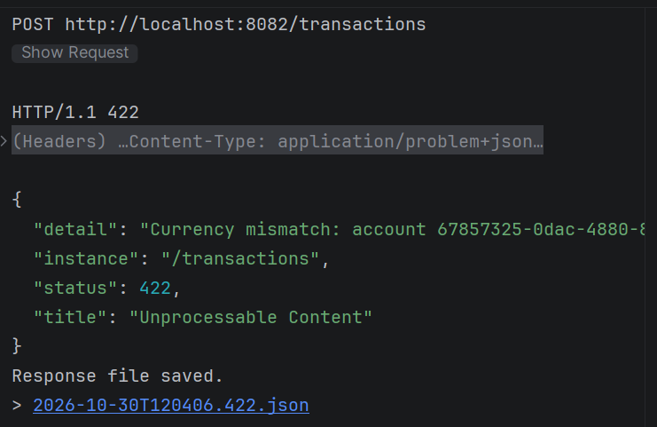                           |
| T5  | Compte inexistant | 404 | 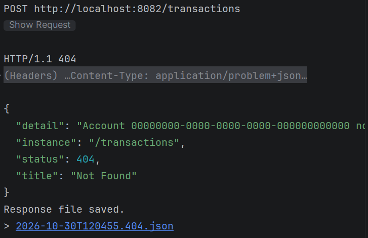                                                    |
| T6  | Montant supérieur au solde | 422 | 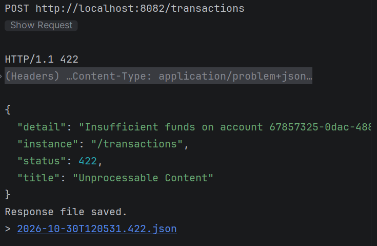                                     |
| T7  | Paiement sur compte bloqué | 422 | 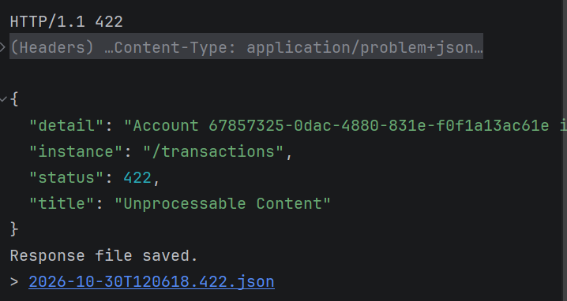                                         |
| T8  | Virement de 50 de A vers B | 201, A égal à 350, B égal à 150 | 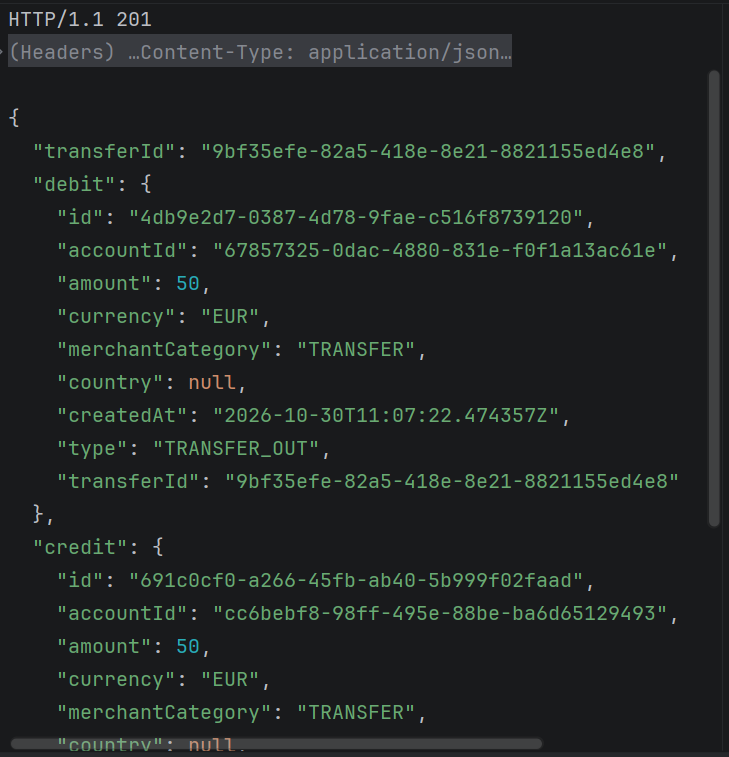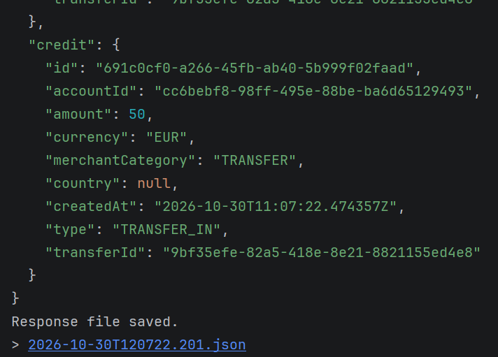                                          |
| T9  | Virement vers le même compte | 422 | 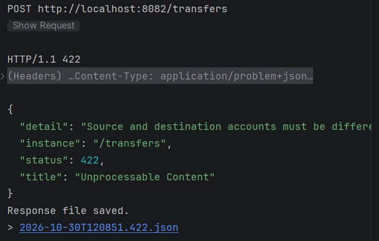                                         |
| T10 | Historique du compte A | 200 | 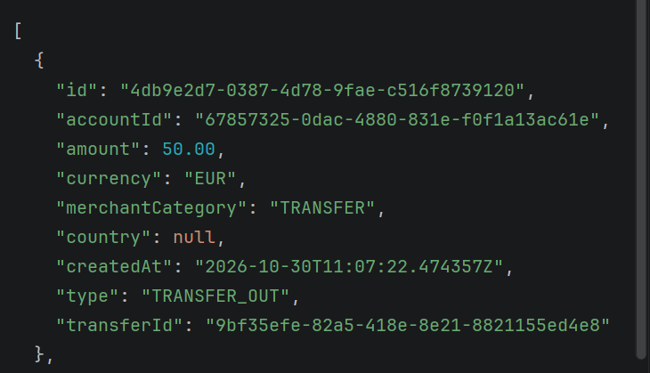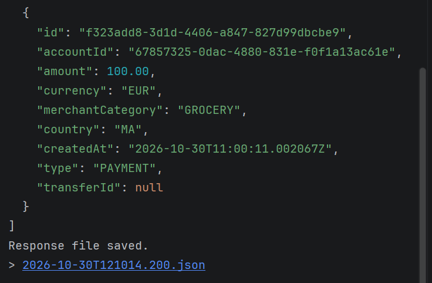                                          |

### Étape 5 - transaction-service : GraphQL et MCP (Partie C.2)

Les connecteurs GraphQL et MCP appellent la même couche `TransactionService` que le connecteur REST. Aucune règle métier n'est écrite dans les connecteurs : le plafond, la devise, le statut du compte et le solde sont vérifiés dans la couche service pour les trois connecteurs.

#### GraphQL

- Schéma : `src/main/resources/graphql/schema.graphqls`
- Point d'accès : `/graphql`, interface de test : `/graphiql`
- Requêtes : `transactions` (filtre optionnel `accountId`), `transaction`
- Mutations : `createTransaction`, `transfer`
- Les erreurs sont converties en `NOT_FOUND` (introuvable), `BAD_REQUEST` (règle métier non respectée) et `INTERNAL_ERROR` (account-service indisponible).
- Limite connue : le montant est exposé en `Float` et la date en `String` (ISO) afin d'éviter une dépendance supplémentaire pour des scalaires personnalisés. Le calcul interne reste en `BigDecimal`.

#### MCP

- Point d'accès : `/mcp` (transport streamable HTTP), nom du serveur : `transaction-mcp-server`
- Outils exposés : `list_transactions`, `get_transaction`, `create_payment`, `transfer_funds`
- Les descriptions des outils indiquent les règles (plafond, devise, compte actif) pour aider le LLM à choisir l'outil et à expliquer un refus.
- Les noms d'outils sont différents de ceux d'account-service, car l'agent sera connecté aux deux serveurs.

#### Tests

| N° | Scénario | Résultat attendu | Capture                   |
|----|---|---|---------------------------|
| G1 | GraphQL : lister les transactions | 200, liste | 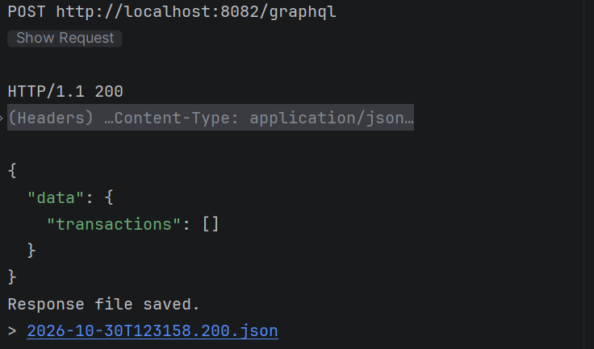 |
| G2 | GraphQL : paiement de 100 sur le compte A | transaction créée, solde de A égal à 400 | 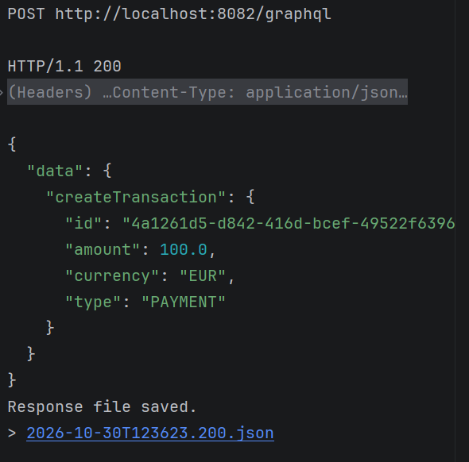 |
| G3 | GraphQL : montant 1500 | erreur BAD_REQUEST (plafond) | 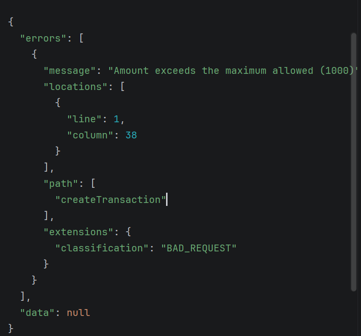 |
| G4 | GraphQL : virement de 50 de A vers B | transferId, deux écritures | 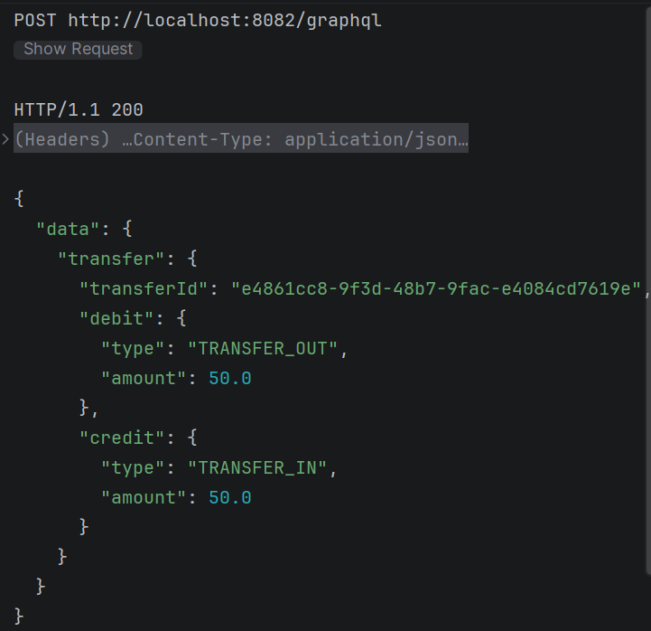 |
| G5 | GraphQL : virement vers le même compte | erreur BAD_REQUEST | 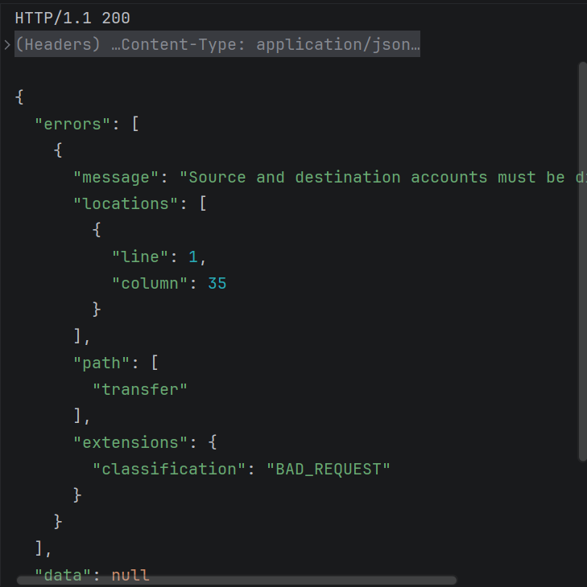 |
| G6 | GraphQL : transaction inexistante | erreur NOT_FOUND | 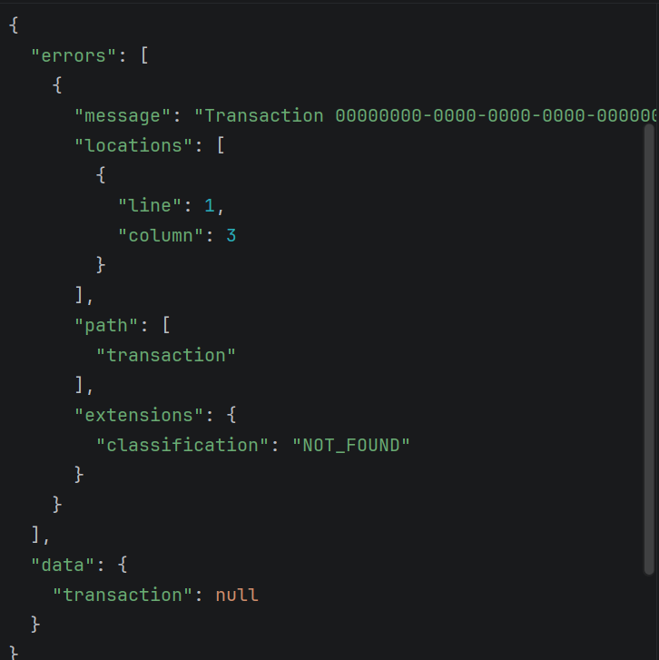                          |
| M1 | MCP : liste des outils | 4 outils |                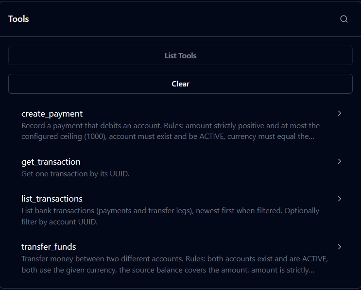           |
| M2 | MCP : list_transactions | historique du compte |            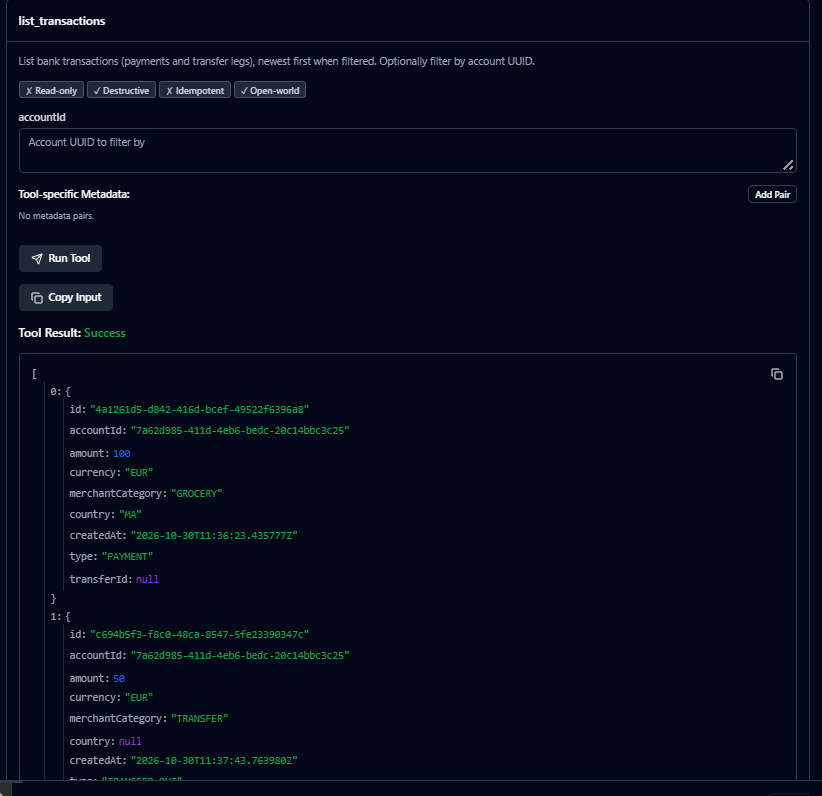               |


## 6. Hypothèses retenues

L'énoncé ne précise pas certains points. Les hypothèses suivantes sont retenues :

- Une transaction est un débit du compte (elle porte une catégorie de commerçant et un pays, ce qui correspond à un paiement).
- Le solde d'un compte ne peut pas devenir négatif.
- Le montant d'une transaction est comparé au plafond `bank.transaction.max-amount`, fourni par le config-service.
## 7. Suite du travail

- [x] Projet Maven parent et module account-service
- [x] Tests de account-service (REST)
- [x] account-service : GraphQL et MCP
- [x] transaction-service : règles métier et virement
- [x] Communication OpenFeign et tolérance aux pannes (Resilience4J)
- [x] transaction-service : GraphQL et MCP
- [ ] Discovery service (Eureka)
- [ ] Config service
- [ ] Gateway (Spring Cloud Gateway)
- [ ] Kafka : producteur et consommateur
- [ ] Agent IA (Spring AI, MCP, Telegram)
- [ ] Diagramme de classes et schéma d'architecture
- [ ] Rapport PDF avec captures d'écran